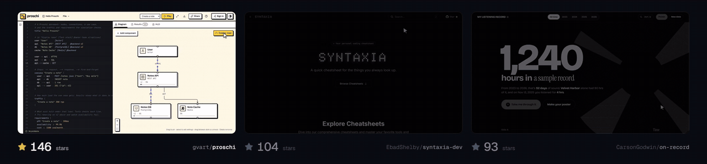

# OpenDemo

Make videos for your github README in a single prompt


*Written, animated and rendered by OpenDemo itself.*

## One prompt

Paste this into Claude Code, Codex or Cursor:

```text
Clone github.com/yasirwhite/OpenDemo and use it to make a launch video for my app
```

Your agent sets it up, records your app, edits the video and hands you an .mp4.



*Made with OpenDemo and merged into the READMEs of [proschi](https://github.com/gvart/proschi), [syntaxia](https://github.com/EbadShelby/syntaxia-dev) and [on-record](https://github.com/CarsonGodwin/on-record).*

---

## More

**README GIF:** add "and a GIF for my README" to the prompt.

**Setting it up yourself:** `npm install` then `npm run build`, once.

**For AI agents:** read [AGENT_README.md](./AGENT_README.md).

<!-- traffic:start -->
## Stats

| | |
|---|---|
| **Unique cloners** | 538 |
| **Last updated** | 2026-11-10 |
<!-- traffic:end -->

## Acknowledgements

OpenDemo builds on the archived OpenScreen project. Thank you to its creator, Siddarth Vaddem, for the foundation of the rendering pipeline.
