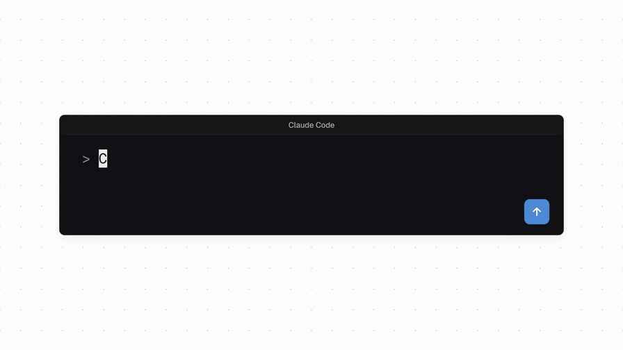

# OpenDemo

Build exciting demo videos for free with the AI you already use.

***No cloud services or API keys.*** Clone OpenDemo and prompt your model.



*Written, animated and rendered by OpenDemo itself.*

## Setup

Needs Node 22. Run once:

```bash
git clone https://github.com/yasirwhite/OpenDemo
cd OpenDemo
npm install
npm run build
```

## Usage

Ask your AI assistant:

```
> Use OpenDemo to generate a video of my new AI recipe app, ChefBot, showing the user onboarding flow.
```

It asks whether you want a simple walkthrough or a launch video *(alpha)*,
then records, edits and hands you an .mp4.

**To change the video**, ask your model, or open it in OpenDemo's editor with
`node OpenDemo/run-demo.mjs <DEMO.json>` (your model can give you the exact command).

**AI agents:** start with [AGENT_README.md](./AGENT_README.md).

## Templates

Want a specific look? Browse the [template gallery](https://yasirwhite.github.io/OpenDemo/)
and copy a prompt.

<!-- traffic:start -->
## Stats

| | |
|---|---|
| **Unique cloners** | 408 |
| **Last updated** | 2026-10-31 |
<!-- traffic:end -->

## Acknowledgements
OpenDemo is built as an automated, agent-native extension of the archived OpenScreen project. A huge thank you to the original OpenScreen creator (Siddarth Vaddem) for laying the foundation of this cinematic rendering pipeline!
